# Hold On Bhai ✋

A browser extension that puts a speed bump between you and the scroll.

It doesn't just block Facebook, YouTube and Gmail. Before you get in, it makes you **breathe** and asks **why** you're there.
Then it gives you a timer, ticks like a clock, beeps when time's up, closes the tab, and shuts the site for the day once your budget is gone.
When you really need to work, **Focus mode** closes every website except the few you allow, with no way out. At night, the **curfew** sends you to bed.

Works on Brave, Chrome, Edge and other Chromium browsers (Manifest V3). Everything stays in your browser. No accounts, no servers.

<p align="center">
  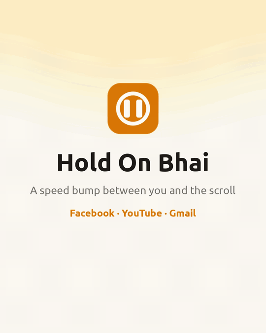
</p>

<p align="center">🎬 <a href="docs/hold-on-bhai-demo.mp4">Watch the demo video with voiceover (MP4, 48 s)</a></p>

---

## Contents

- [Quick start](#quick-start)
- [How to use it day to day](#how-to-use-it-day-to-day)
- [The pause screen](#-the-pause-screen)
- [While you're on the site](#while-youre-on-the-site)
- [Learn, Chill and Class](#-learn-chill-and-class)
- [Gmail](#-gmail)
- [Focus mode](#-focus-mode)
- [Curfew](#-curfew)
- [The toolbar popup and stats](#-the-toolbar-popup-and-stats)
- [The settings lock](#-the-settings-lock)
- [Honest limitations](#honest-limitations)
- [Project layout](#project-layout)

---

## Quick start

1. **Get it.** Download **hold-on-bhai-v1.0.0.zip** from the [latest release](https://github.com/AtiQ-Rahman/Hold-On-Bhai/releases/latest) and unzip it.
   Or clone the repo: `git clone https://github.com/AtiQ-Rahman/Hold-On-Bhai.git`
2. Open `brave://extensions` (or `chrome://extensions`).
3. Turn on **Developer mode** (top right).
4. Click **Load unpacked** and pick the unzipped `hold-on-bhai` folder (or the repo's `extension` folder).
   Keep that folder where it is. The browser loads the extension from it.
5. **Save the password.** A welcome page shows it **once**. Put it somewhere annoying to reach, or send it to a friend.
6. **Pin it.** Click the puzzle icon 🧩 next to the address bar, then the pin next to Hold On Bhai. Now the Focus button is one click away.
7. **Turn on "Allow in Private"** on the extension card, or private windows skip all of this.
8. You have **30 minutes** to set things up in Settings (budgets, curfew, sites). After that, settings lock.

**Updating:** download the new zip and unzip it over the same folder (or `git pull`), then click the reload icon ↻ on the extension card.
Your stats, password and budgets stay.

---

## How to use it day to day

| When | What to do |
|---|---|
| **You open Facebook, YouTube or Gmail** | Take the slow breaths, pick Learn or Chill, say why, pick a timer. Be honest, your stats are watching. |
| **You need a login code** | Gmail → **🔑 Grab a login code**. One breath, 2 minutes. |
| **You're done early** | Click **I'm done** on the timer badge. Closing early is a W. |
| **Time's up** | Tap how you feel, then close it. Need more? Wait and type the sentence. Every extension costs more. |
| **Learning something** | Pick 📚 **Learn**. You get locked to one video, group or page. |
| **A long class** | Learn → tick **🎓 This is a class**, pick 1h to 3h. It doesn't touch your Learn budget. |
| **You need to study or work** | Toolbar icon → 🎯 **Focus mode** → pick a time → tap **Lock in** twice. Or press **Alt+Shift+F**. |
| **Before bed** | Set a 🌙 **curfew** once in Settings (for example 12:00 AM to 7:00 AM). It runs every night. |
| **Once a week** | Open **Stats**. Look at when and why you open these sites, and how you felt after. |

---

## 🫁 The pause screen

Opening a tracked site first shows **"Hold on, bhai ✋"** and a breathing exercise.
A ball grows while you **breathe in for 4 seconds** and shrinks while you **breathe out for 6**, with a soft breath sound for each.
You can only go on after the last breath.

<p align="center">
  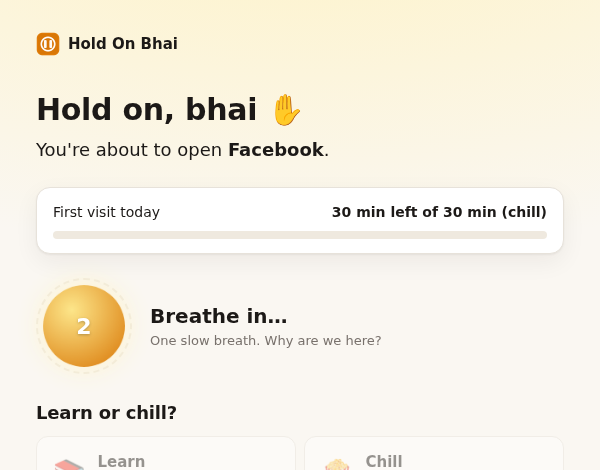
  <br><br>
  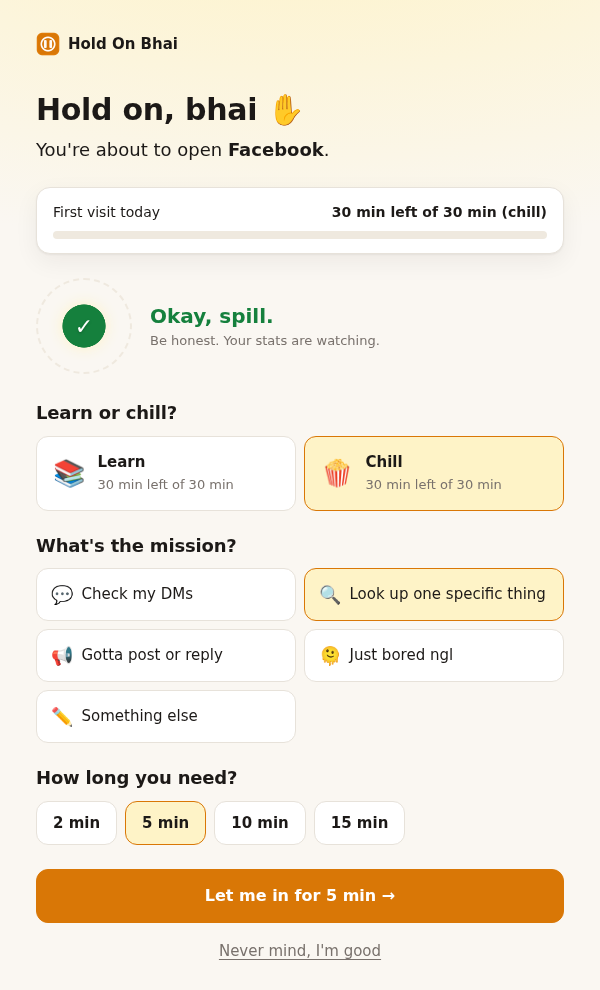
</p>

- **3 breaths** for every site, **1 for Gmail** (so a login code is quick). Change the count per site in Settings.
- **Fixed or rising:** by default it's the same count every time. A site can switch to "add more each visit",
  which starts at that site's count and grows the same day (3, 3, 3, 4, 6). Rising is never easier than fixed.
- **Why are you here?** Check my DMs, look up one specific thing, gotta post or reply, just bored ngl, or write your own.
- **Bored mode:** "Just bored ngl" caps the timer at 5 minutes and suggests side quests instead.
- **Smart redirect:** "Check my DMs" takes you straight to the inbox.
- **Daily budget:** Facebook, YouTube and Gmail get **30 minutes of chill a day** each. When it's gone, the site stays closed until midnight. No override.

<p align="center">
  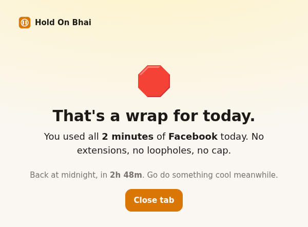
</p>

---

## While you're on the site

- A **timer badge** in the corner shows the time left and your reason.
- **The timer only runs while the site is on screen.** Switch to another tab or minimize the window and it pauses;
  come back and it picks up where it left off. Left paused for 30 minutes, the session ends and the site goes back to the pause screen.
- **Tick tick:** a clock ticks while you're on the site. Louder in the last minute, faster in the last 10 seconds.
  Change the sound volume anytime from the toolbar popup, no password.
- **Black & white:** Chill goes grayscale by default. Colors are half the dopamine. Learn and Class keep their colors.
- **Chill is your time:** you earned it at the door, so the feed, reels and recommendations all show. The budget and the timer are the limit.
  Want the feed hidden in Chill too? Turn on **Hide the feed in Chill too** for that site in Settings.

<p align="center">
  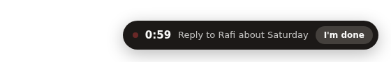
</p>

**When time's up:**
- **Peep peep**, the page gets covered, and you rate the vibe: better, meh or worse.
- In strict mode you get 15 seconds, then **every tab of that site closes**.
- **Extensions cost effort:** wait a countdown (it doubles each time), then type *"I choose to spend 2 more minutes here"*. No copy-paste.

<p align="center">
  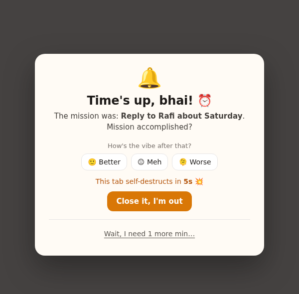
</p>

---

## 📚 Learn, Chill and Class

YouTube and Facebook ask **"Learn or chill?"** and keep separate budgets.

| | YouTube | Facebook |
|---|---|---|
| **🍿 Chill budget** | 30 min a day | 30 min a day |
| **📚 Learn budget** | 120 min a day | 30 min a day |
| **Learn is locked to** | one video | one group, page or video |
| **Learn timer** | video length + 5 min | you pick 10, 15, 20 or 30 min |
| **No link yet?** | 5 min to find a video. The first one you open becomes the lock. | You start at "Your groups". The first group, page or video you open becomes the lock. |

- In Learn, anything else (the feed, reels, other videos, other groups) sends you back to the pause screen.
- **Every 10 minutes** the video pauses and asks **"Still learning or vibing? 👀"**
- **Learn is distraction-free:** no home feed, no sidebar, no end screens, no comments, no Shorts (they open in the normal player), autoplay off.

<p align="center">
  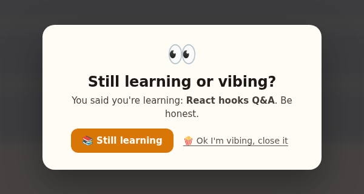
</p>

### 🎓 Class

For a long class or a live stream on YouTube or Facebook:

1. Pick **Learn**, type the class name, and tick **🎓 This is a class**.
2. Pick the length: **1h, 1.5h, 2h or 3h**.
3. Take **3 more slow breaths**. Then start.

- The class is **locked to one video or group**, like Learn. Live streams work.
- It **doesn't use your Learn budget**. Instead you get **1 class a day** (Settings → Classes per day, up to 5).
- Every **30 minutes** a small note asks if you're still in class. The video keeps playing.

<p align="center">
  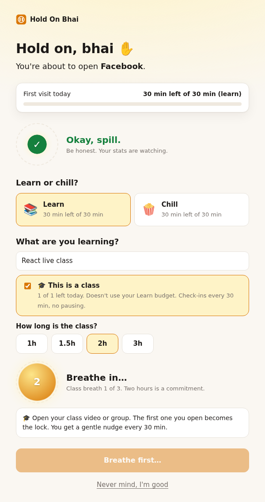
</p>

---

## 📧 Gmail

- Gmail goes through the pause screen too, with **1 breath**, so checking it "just in case" always costs a moment.
- **🔑 Grab a login code:** a Gmail-only reason that gives you 2 minutes, tops.
- 30 minutes a day, a timer and the tab closes when time's up, like every other site. The inbox stays visible.
- It covers every Gmail account in this browser, including a work account on Google Workspace.
  Use a separate browser profile for work if you need it open all day.

---

## 🎯 Focus mode

For when you really need to work.

1. Click the Hold On Bhai icon (or press **Alt+Shift+F**).
2. Pick **25m, 50m, 90m, 2h**, or type your own minutes.
3. Tap **🔒 Lock in**, then tap again to confirm.

Until the timer ends:
- **Every website is closed.** Google, news, shopping, all of it. Only the sites you allow open
  (Settings → 🎯 Focus mode → *Open during Focus*; `localhost` and `127.0.0.1` by default, subdomains included).
- Sites on your list stay closed even if you allow them, even the ones you switched off (Instagram, X, Reddit).
- Learn and Class are off too. Any running session ends.
- The **extensions page is blocked**, so you can't disable Hold On Bhai from there.
- Settings can't be saved.
- **There's no cancel.** You can only add time (+15 min).
- The toolbar icon shows the minutes left in red.

<p align="center">
  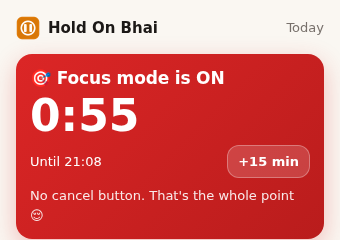
  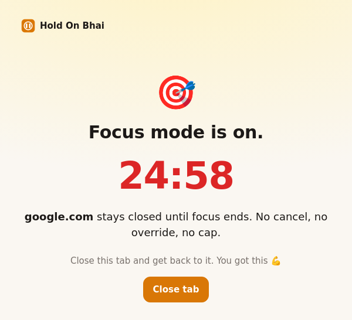
</p>

---

## 🌙 Curfew

A daily window when tracked sites stay closed, for example 12:00 AM to 7:00 AM.

- Set it in **Settings → Curfew**. It's off until you turn it on.
- Running sessions end when the curfew starts. Timers never run past it.
- The toolbar icon shows **zz** during the curfew.
- **Making it longer works anytime.** Making it shorter or turning it off follows the [settings lock](#-the-settings-lock), so 1 AM-you can't cheat.

<p align="center">
  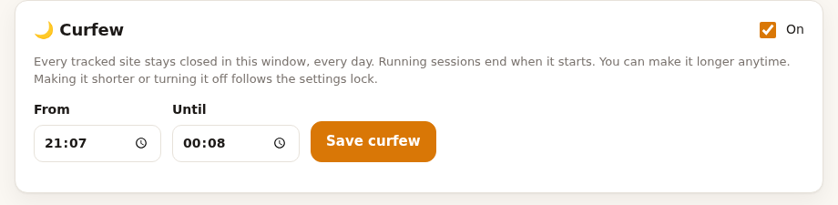
  <br><br>
  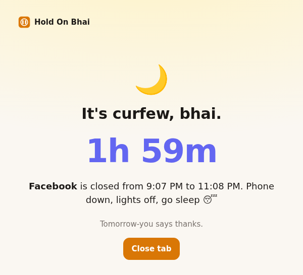
</p>

---

## 📊 The toolbar popup and stats

- The popup has the big **🎯 Focus mode** button, the curfew, each site's **chill budget** for today,
  and at the bottom today's **🍿 Chill, 📚 Learn and 🎓 Class** totals.
- The **Stats** page has minutes per day, opens, reasons, moods and recent visits,
  plus patterns like *"After bored visits you felt worse 75% of the time."*

<p align="center">
  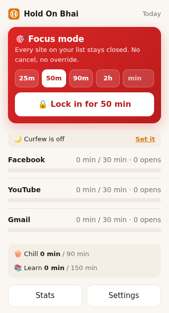
</p>

---

## 🔒 The settings lock

- On install, the extension **generates a password** and shows it **once**.
- For the first **30 minutes**, every setting is open so you can set things up.
- After that, the rule is simple:

| Change | What happens |
|---|---|
| **Stricter** (add a site, lower a budget, more breaths, rising breaths, turn tracking or hide-the-feed on, a longer curfew, more black & white) | Saves right away. No password. |
| **Looser** (raise a budget, stop tracking a site, fewer breaths, back to fixed breaths, a shorter curfew, less black & white) | First **10 slow breaths**, then the password. The change **kicks in 24 hours later** on its own. |

- Every loosening costs 10 more breaths than the last: 10, 20, 30, up to 60 (10 minutes). A week without loosening anything resets it to 10.
- Scheduled changes show up at the top of Settings. Cancel any of them if the craving's gone. Most don't survive a day.
- Mixed edit? The stricter part saves now, the looser part waits. Or tap **Save only the stricter stuff**.
- During Focus mode, nothing in Settings can be saved, and scheduled changes wait until it's over.
- Five wrong passwords lock attempts for an hour.
- The built-in sites (Facebook, YouTube, Gmail, Instagram, X, Reddit) can be switched off but never removed, and their domains always stay.
  Sites you add yourself can be removed.

---

## Honest limitations

A browser extension can slow you down, but it can't stop a fully determined you:

- You can still remove it by right-clicking the toolbar icon, or disable it from the extensions page (except during Focus mode).
  Reinstalling resets the password, budgets and stats.
- It only works in this browser. For your phone, use Digital Wellbeing (Android) or Screen Time (iPhone).
- Private windows are only covered if you turn on **Allow in Private**.
- Hiding the feed in Learn depends on each site's page structure, which changes now and then.

The point is to put enough friction between the impulse and the scroll that you get a moment to choose.

---

## Project layout

```
extension/
  manifest.json
  background.js        sessions, timers, budgets, focus, curfew, settings lock (service worker)
  lib.js               shared helpers and defaults
  content/             timer badge, time's-up overlay, check-ins, feed hiding
  pages/               pause screen, breathing, popup, settings, stats, welcome, offscreen audio
  icons/
docs/                  demo.gif, demo video and screenshots used in this README
```
